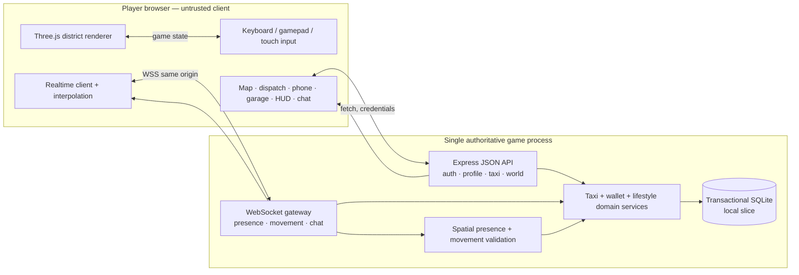
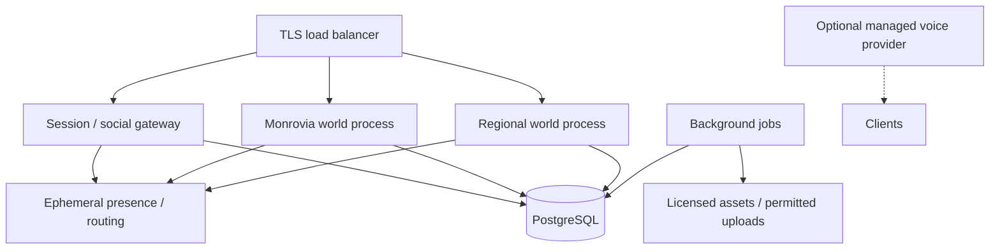

# Taxi-LIB system architecture

## Vertical-slice diagram

The production client bundle contains no database credentials or administrative secrets. Normal deployments use an HttpOnly, SameSite session cookie. Because some embedded browsers partition or suppress cookies, the Arena preview additionally returns a tab-scoped bearer session for API requests; realtime connections then obtain a 30-second, single-use ticket, so the long-lived session token is never placed in a WebSocket URL. Financial writes run in database transactions with lifecycle checks and unique ledger references.

## Module boundaries

- `src/shared`: typed wire contracts, canonical lifestyle catalogs/home room layouts, simulation constants, locations and road graph. Pure and usable on both sides.
- `src/server/db`: iterative migrations and transaction boundary.
- `src/server/services`: authentication, profiles, presence, taxi lifecycle, lifestyle purchases/selection/upgrades and wallet/ledger invariants.
- `src/server/realtime`: socket authentication, rate limits, interest-filtered replication and chat.
- `src/client/world`: procedural district, materials, navigation, environmental systems and disposable furnished owned-home interior instances.
- `src/client/entities`: character/vehicle models, headlight rigs, animation and disposal.
- `src/client/systems`: controls, physics, scripted phone calls, weather, sound and map projection.
- `src/client/ui.ts`: connected menus, HUD, dispatch, compact-phone showroom/property/garage apps, owned-home room navigator, map, settings and chat.

## Evolution to regional scale

This is a scaling direction, **not a tested claim of thousands of concurrent users**. The current process uses in-memory presence and distance-based interest filtering. Before sharding: profile with real clients, add PostgreSQL, move presence routing to a measured coordination layer, define handoff between regions, and load-test reconnect storms.

## Realtime model

- Client sends compact movement states at 10 Hz; server validates and replicates relevant states.
- Remote entities interpolate over a short buffer; local movement remains responsive.
- The server records last accepted pose and mode for trip validation. Interior presence is validated against owned property IDs; the network pose remains outside and indoor remote avatars are hidden.
- Money, ownership, inventory and mission lifecycle never rely on client success messages.
- Chat has per-connection rate limits and distance-scoped delivery.
- Reconnection uses the persistent session; active accepted/active trips are returned by world bootstrap.

## Health and observability

`GET /health` reports process liveness and database accessibility. Structured request/error logs and audit records cover important auth and economic events. Production requires external metrics, alerts, backups and restore drills before a public test.
